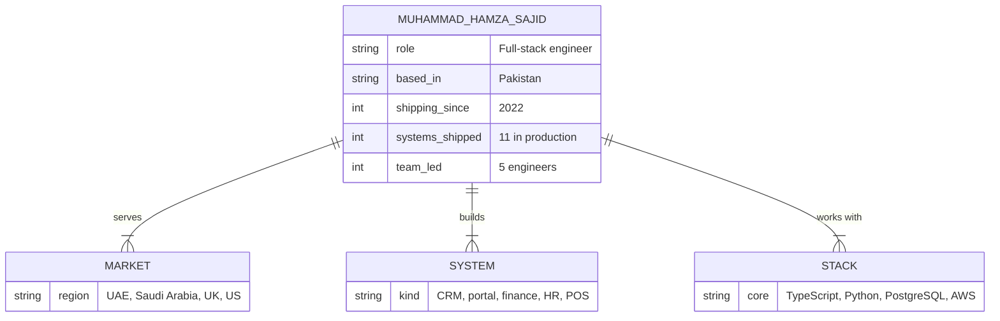

 

 

## About

I'm a full-stack engineer with 4+ years of shipping production systems. 

Every project starts the same way: I sit with the business, find where records don't line up and where people are doing by hand what software should do, and design the data model before anything else. Here's mine.

 

## Building now

  

<b>What each one does</b>

 

| System | What it does |
|---|---|
| **School management portal** | Separate portals for the admin, teachers and parents of a 1,000+ student campus. Fee cycles, class records, teacher recognition and AI-written progress reports. Parent complaints go to the director, who investigates before anything is recorded against a teacher. |
| **Finance management system** | Replaces manual ledgers and spreadsheet reconciliation with one tracked record of where a client's money goes. |
| **Lead pipeline CRM** | A sales pipeline with its own MCP server, so an AI agent can create leads, log activity, send email and open tasks without anyone copying data across. |
| **Offline-first point of sale** | Keeps selling when the connection drops and syncs every sale once it's back. |
| **Invoice import with OCR** | Reads supplier invoices in local Pakistani formats and turns them into structured data for the point of sale. |
| **Autonomous publishing pipeline** | A Google Sheets content queue feeds an Apps Script scheduler that publishes to Facebook and Instagram through the Meta Graph API every day. |

 

## Selected work

| System | What it does | Built with |
|---|---|---|
| **HakemAI** | Insurance comparison platform. Parses rate tables out of insurer PDFs, ranks plans with an AI scoring model and compares RFQs side by side. I also ran its live production migration under a client deadline. | `Next.js` `FastAPI` `PostgreSQL` `MongoDB` |
| **Liquidity Sweep Trader** | Algorithmic trading engine on a six-stage state machine, with a Django control dashboard connected to MetaTrader 5. | `Python` `Django` `MT5 API` |
| **Swaapty** | Real-time marketplace where people swap products instead of selling them. | `Next.js` `NestJS` `TypeORM` `PostgreSQL` `Docker` `Nginx` |
| **Hospital HR system** | Staff records and day-to-day HR administration for a hospital workforce. | `Angular` |
| **HR Strategy Studio** | HR management system shaped around how an HR team actually plans and runs its work. | |
| **Foodify** | Restaurant management system for menus, orders and daily operations. | |
| **BlissChat** | Social platform with WebSocket messaging and a custom admin panel. | `React` `Django` `PostgreSQL` `WebSockets` |
| **Saleto** | Email management platform on a self-hosted mail server, with async send and receive tracking. | `Angular` `Django` `Celery` `Redis` `Postfix` `Dovecot` |
| **SecureChat** | Privacy-first messenger: end-to-end encryption, self-deleting messages, screenshot blocking, voice notes, QR contact discovery. | `Flutter` `BLoC` `Firebase` |
| **UK Company Scraper** | Pulls company data from five sources concurrently and exports it to CSV and Excel. | `Python` `Django` `PostgreSQL` |
| **Greentech** | Website for an HVAC company. | |

 

## Experience

**Lead engineer** &nbsp;·&nbsp; Software studio &nbsp;·&nbsp; Mar 2026 – NOW
 Scope each client's operational problems and build the system that fixes them. 

**Senior software engineer** &nbsp;·&nbsp; Camden Health System, Lahore &nbsp;·&nbsp; AUG 2024 – FEB 2026
 Set technical direction across four concurrent products. Led five engineers, owned the AWS infrastructure and introduced the WebSocket architecture the frontend team adopted.

**Software engineer** &nbsp;·&nbsp; HurTech, Bahawalpur &nbsp;·&nbsp; MAR 2022 – JUL 2024
 Most senior engineer on the team. Architected and delivered five full-stack applications across point of sale, workforce management and client platforms, including RBAC, real-time sync and payments.

**BS Information Technology** &nbsp;·&nbsp; The Islamia University of Bahawalpur &nbsp;·&nbsp; 2021 – 2025

 

## Tools

| | |
|---|---|
| **Frontend** |  |
| **Backend** |  |
| **Data** |  |
| **Infrastructure** |  |
| **Mobile & desktop** |  |
| **AI & automation** | PDF extraction pipelines, OCR, AI ranking and scoring, web scraping, Celery queues, MCP servers, Claude Code with sub-agents, Meta Graph API, Google Apps Script |

 

## Activity

  

 

**If your team still keeps the business in spreadsheets, manual work, I'd like to build what replaces them.**

<a href="mailto:codx.hamza@gmail.com">codx.hamza@gmail.com</a>

